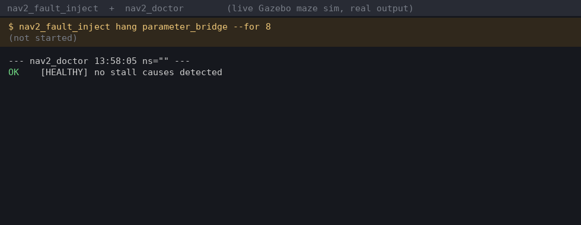

# nav2_fault_inject

[](https://github.com/darshmenon/nav2_fault_inject/actions/workflows/ci.yml)
[](https://docs.ros.org/)
[](LICENSE)

**Does your robot notice when something dies?** Freeze any node of a running ROS 2 stack for a few seconds and watch what happens. No remaps, no rebuild, no root.



*Real run on a Gazebo maze sim: the bridge is frozen for 8 s, `nav2_doctor` names the cause about 3 s later, and both recover when it resumes. Raw logs: `docs/demo_raw.txt`, `docs/demo_events.txt`; renderer: `docs/make_demo_gif.py`.*

Built alongside [rosnav](https://github.com/darshmenon/rosnav), a ROS 2 Nav2 stack with SLAM, frontier exploration and multi-robot fleets, and tested on its live Gazebo maze sim.

## Quick start

```bash
ros2 run nav2_fault_inject nav2_fault_inject list                          # nodes you can target
ros2 run nav2_fault_inject nav2_fault_inject hang parameter_bridge --for 10   # sim bridge: sensor and TF dropout for 10 s
ros2 run nav2_fault_inject nav2_fault_inject hang controller_server --for 5    # a hung controller
ros2 run nav2_fault_inject nav2_fault_inject run scenario.yaml --timeline out.json
ros2 run nav2_fault_inject nav2_fault_inject --dry-run hang bt_navigator --for 3   # show it, touch nothing
```

```yaml
# scenario.yaml - each node is frozen at `at` seconds for `for` seconds
faults:
  - {at: 20, node: parameter_bridge,  for: 8}
  - {at: 45, node: controller_server, for: 5}
```

Add `expect:` and `run --check` to turn a scenario into a pass/fail test (needs [nav2_doctor](https://github.com/darshmenon/nav2_doctor)):

```yaml
faults:
  - at: 20
    node: parameter_bridge
    for: 8
    expect: {detect: [SCAN_STALE], within: 8, clear_within: 20, forbid: [GOAL_FLAPPING]}
```

```
PASS  parameter_bridge @20s for 8s
       ok   detect SCAN_STALE: seen 2.1s after the pause
       ok   clear: healthy 3.0s after the resume
```

Output (each line carries wall-clock time, so it lines up with other tools' logs):

```
13:58:10 [  0.02s] PAUSE   parameter_bridge (pid 511740)
13:58:18 [  8.02s] RESUME  parameter_bridge (pid 511740)
```

## How it works

Pausing the process that hosts a node (`SIGSTOP`, then `SIGCONT`) freezes everything it publishes. Freezing the sim bridge is a sensor and TF dropout; freezing `controller_server` is a hang.

- **Safe by construction.** Only processes in your own `ROS_DOMAIN_ID` that were started with `--ros-args` are touched, and the node name or executable name must match exactly. Every paused process is resumed on exit, on error, on Ctrl+C and on `SIGTERM`.
- **Fails before it breaks anything.** A scenario that names a missing node aborts before pausing anything.
- **Reproducible.** Scenarios are timed files, and `--timeline` writes what was paused and resumed, and when.
- **Tested for real.** The test suite freezes and thaws an actual throw-away process, checks that Ctrl+C never leaves it frozen, and needs no ROS.

## Why

Most robot stacks are only ever tested on the happy path. This makes "what if the lidar bridge dies for 8 seconds?" a one-line experiment. Pair it with [nav2_doctor](https://github.com/darshmenon/nav2_doctor) to see whether anything notices, and with [nav_explore_eval](https://github.com/darshmenon/nav_explore_eval) to measure what the fault cost an exploration run.

## Limits

- A node composed inside another process pauses together with that whole process.
- Pausing models a hang or a silent sensor, not corrupted data, a slow topic or a dropped network link.
- Linux only (`/proc` and POSIX signals).

## Roadmap

- topic faults through a relay: drop, delay, rate limit; `cmd_vel` blackhole; clock jump
- seeded random chaos mode; kill-and-respawn checks; CPU load
- PyPI release

Build: `colcon build --packages-select nav2_fault_inject`. Tests: `python3 -m pytest test` (no ROS needed).
